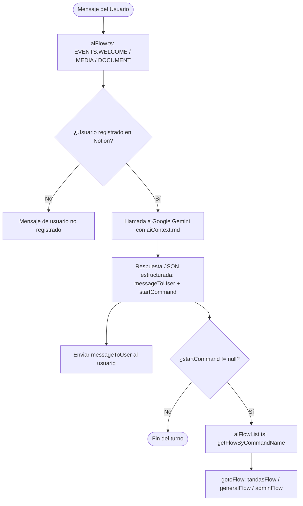

# AGENTS.md — Guía para Agentes de IA en TandasBot

Este documento proporciona una guía completa y estructurada sobre la arquitectura, funcionamiento, convenciones y herramientas del proyecto **TandasBot**, diseñada específicamente para que agentes de IA puedan entender, mantener y extender el código con precisión.

---

## 1. Visión General del Proyecto

**Tandasbot** es un bot de WhatsApp para administrar y automatizar el cobro de suscripciones compartidas ("tandas"). El catálogo de tandas de Notion es la fuente de verdad; no hay servicios fijos en el código ni utilidades personales ajenas a las tandas.

### Capacidades principales:
1. **Atención Conversacional con IA**: Integra Google Gemini (`@google/genai`) para responder dudas en lenguaje natural con personalidad personalizada y dirigir al usuario al flujo correcto.
2. **Gestión de Suscripciones ("Tandas")**: Soporte para modelos mensuales y anuales, control de costos compartidos y cálculo de pagos adeudados.
3. **Registro y Validación de Comprobantes**: Los usuarios envían capturas de pantalla de sus transferencias; el bot las almacena localmente y las sube automáticamente a Notion como comprobante de pago.
4. **Recordatorios Automatizados (Cron)**: Tarea programada diaria (10:00 AM) que calcula deudores y envía avisos preventivos y de mora según días de vencimiento.
5. **Persistencia en Notion**: Utiliza cuatro tablas relacionales —Usuarios, Listado Tandas, Legales Usuarios Tandas y Listado de Pagos— mediante el SDK v5 (`dataSources` y `fileUploads`).

---

## 2. Stack Tecnológico

| Componente | Tecnología | Versión / Detalle |
| :--- | :--- | :--- |
| **Runtime** | Node.js | v20+ (ESM nativo, `"type": "module"`) |
| **Lenguaje** | TypeScript | v5.4.3 (Target ES2022) |
| **Gestor de Paquetes** | pnpm | Obligatorio (usado en Docker y local) |
| **Bot Framework** | BuilderBot (`@builderbot/bot`) | v1.5.2 |
| **WhatsApp Provider** | `@builderbot/provider-baileys` | v1.5.2 (Baileys) |
| **Bot State DB** | `@builderbot/database-json` | v1.5.2 (`db.json`) |
| **Database Principal** | Notion SDK (`@notionhq/client`) | v5.3.0 (API de DataSources y FileUploads) |
| **Motor de IA** | Google Gen AI SDK (`@google/genai`) | v1.52.0 (configurado vía env) |
| **Scheduler** | `node-cron` | v4.6.0 |
| **Bundler** | `tsup` | v8.5.1 (con loader de `.md` a texto) |
| **Servidor HTTP** | Express | v5.1.0 (servidor web interno de BuilderBot en puerto 3008) |
| **Logger** | `pino` + `pino-pretty` | Salidas estructuradas con colores |
| **Manipulación de Imágenes**| `sharp` | v0.32.6 |

---

## 3. Estructura del Proyecto

```
tandasbot/
├── .env.example              # Plantilla de variables de entorno requeridas
├── Dockerfile                # Configuración multi-stage para despliegue en contenedor
├── deploy.sh                 # Script bash para actualización automática en servidor PM2
├── package.json              # Scripts y dependencias
├── tsconfig.json             # Configuración TypeScript y alias de rutas
├── tsup.config.ts            # Configuración de compilación con tsup
├── globals.d.ts              # Declaración para importación de archivos *.md
├── src/
│   ├── app.ts                # Punto de entrada principal y configuración del cron diario
│   ├── config/
│   │   ├── aiContext.md      # Instrucciones de sistema y personalidad de Tandasbot
│   │   ├── aiModel.ts        # Inicialización de Gemini y esquema de respuesta JSON
│   │   ├── database.ts       # Inicialización de JsonFileDB de BuilderBot
│   │   └── provider.ts       # Versión más reciente de WhatsApp Web y configuración del provider
│   ├── constants/
│   │   ├── menu.ts           # Opciones dinámicas por tandas asignadas y rol
│   │   ├── messages.ts       # Mensajes estándar (errores, no autorizado, términos)
│   │   ├── paths.ts          # Rutas locales (ej. 'vouchers')
│   │   ├── tandasRules.ts    # Generador genérico de reglamento desde Notion
│   │   └── users.ts          # Helper de administradores dinámicos
│   ├── enums/
│   │   ├── bot-commands.ts   # Comandos textuales exactos del bot
│   │   ├── suscriptions.ts   # Tipos de suscripción ('monthly' | 'annual')
│   │   └── users.ts          # Grupos genéricos de compatibilidad
│   ├── flows/
│   │   ├── index.ts          # Registro maestro de todos los flujos de BuilderBot
│   │   ├── aiFlow.ts         # Flow principal: captura mensajes/archivos y delega a Gemini
│   │   ├── aiFlowList.ts     # Mapeo de `startCommand` a flows de ejecución de BuilderBot
│   │   ├── generalFlow.ts    # Flujo de menú general (`menú` / `menu`)
│   │   ├── adminFlow.ts      # Difusión, adeudos, precio, contraseña, estatus y cron
│   │   ├── idleFlow.ts       # Timeout de inactividad de 5 minutos
│   │   └── tandasFlow.ts     # Flujos genéricos por tanda: pagar, estado, reglas y términos
│   ├── types/
│   │   ├── aiResponse.d.ts   # Tipado de la respuesta JSON del modelo de IA
│   │   ├── debtors.d.ts      # Tipado de deudores de tandas
│   │   ├── messages.d.ts     # Tipado de mensajes de WhatsApp
│   │   ├── payments.d.ts     # Tipado de transacciones de pago
│   │   └── notion/           # Tipados específicos para propiedades de Notion
│   └── utils/
│       ├── datetimes.ts      # Cálculos de fechas, diferencias en meses/años/días y zona horaria
│       ├── files.ts          # Guardado local de comprobantes y subida vía Notion File Uploads
│       ├── logger.ts         # Instancia configurada de Pino Logger
│       ├── misc.ts           # Formateador de moneda (MXN) y transformaciones de texto
│       ├── flowHelpers.ts    # Typing, cancelación y debounce de mensajes
│       ├── tandas.ts         # Adeudos, crédito, periodos, recordatorios y acciones admin
│       ├── users.ts          # Validación de permisos y envío masivo/individual de mensajes
│       ├── whatsapp.ts       # Utilidad para sanitizar números de teléfono desde JID
│       └── notion/
│           ├── client.ts     # Cliente oficial de Notion
│           ├── legalsDB.ts   # Relación usuario–tanda: reglas, inicio y saldo a favor
│           ├── tandasDB.ts   # Queries y mutaciones de Tandas y Pagos en Notion
│           └── usersDB.ts    # Usuarios, admins y membresías relacionales
```

---

## 4. Arquitectura de Flujos y Enrutamiento con IA

El flujo conversacional funciona mediante un patrón híbrido **IA Router + State Machine**:



### Protocolo de respuesta de Gemini (`src/config/aiModel.ts`)
Gemini siempre responde un objeto JSON validado por esquema:
```json
{
  "messageToUser": "Mensaje en formato WhatsApp (usar *negritas*, _cursivas_, emojis moderados)",
  "startCommand": "comando exacto de BOT_COMMANDS o vacío"
}
```

### Comandos soportados (`src/enums/bot-commands.ts`)
- **Generales**: `menú`, `menu`, `datos de pago` (exclusivamente para pagos de tandas).
- **Admin**: `mensaje a grupo`, `mensaje personalizado`, `estatus tandas`, `reenviar recordatorios tandas`, `estatus usuario`, `regalar periodos`, `cambiar precio tanda`, `cambiar contraseña tanda`.
- **Por tanda**: `pagar <tanda>`, `mi <tanda>`, `reglamento <tanda>`. Se resuelven mediante el nombre normalizado de una tanda activa de Notion.

---

## 5. Esquema de Base de Datos (Notion Data Sources)

El bot requiere 4 bases de datos relacionales en Notion vinculadas al token de integración (`NOTION_API_TOKEN`):

### 1. Base de Datos de Usuarios (`NOTION_USERS_DATASOURCE_ID`)
- `Nombre` (*Title*): Nombre completo del usuario.
- `Telefono` (*Phone*): Número con código de país (ej. `52155...`).
- `Admin?` (*Checkbox*): Autoriza los flujos administrativos y recibe notificaciones.
- `Tandas` (*Relation*): Membresías hacia `Listado Tandas`.

### 2. Base de Datos de Tandas (`NOTION_TANDAS_LIST_DATASOURCE_ID`)
- `Nombre tanda` (*Title*), `Activo?` (*Checkbox*) y `Recurrencia` (*Select*: `monthly` / `annual`).
- `Dia de pago` (*Date*), `Costo tanda` (*Number*), `Numero de miembros` (*Number*) y `Costo por miembro` (*Formula*).
- `password` (*Rich text*) y `Reglas tanda` (*Rich text*), ambos gestionados sin hardcodear un servicio.

### 3. Legales Usuarios Tandas (`NOTION_TANDAS_LEGALES_DATASOURCE_ID`)
- `Nombre` (*Title*), `Usuario` (*Relation*) y `Tanda` (*Relation*) identifican la membresía.
- `Fecha inicio` (*Date*) y `Acepto reglas` (*Checkbox*) controlan el acceso al pago/consulta.
- `Saldo a favor` (*Number*) conserva los remanentes de pagos parciales y de ajustes de precio.

### 4. Listado de Pagos (`NOTION_TANDAS_PAYMENTS_DATASOURCE_ID`)
- `Titulo` (*Title*), `Usuario` (*Relation*), `Tanda` (*Relation*), `Fecha pago` (*Date*) y `Monto` (*Number*).
- `Siguiente pago` (*Date*) mantiene fijo el día de corte de la tanda; `Comprobante` almacena el archivo subido.
- `Periodos pagados` y `Vencido?` son fórmulas de solo lectura de Notion.

---

## 6. Lógica de Negocio Crítica

### A. Registro de Pagos (`src/utils/tandas.ts: handleTandaPayment`)
1. Suma el monto recibido al `Saldo a favor`, divide entre el costo por integrante (`costPerUser`) y redondea hacia abajo (`Math.floor`) para obtener `paidPeriods`.
2. Calcula la fecha de `nextPayment`:
   - Si existen pagos previos: añade `paidPeriods` a la fecha del último `nextPayment`.
   - Si es el primer pago: calcula a partir de `Fecha inicio` de `Legales Usuarios Tandas` o del corte actual de la tanda.
   - Solo avanza cuando se cubre al menos un periodo y siempre conserva el día definido en `Dia de pago`.
3. Almacena el comprobante localmente en `vouchers/<userId>/<timestamp>.<ext>`.
4. Sube el archivo a Notion mediante la API `fileUploads.create` y `fileUploads.send`, obteniendo `fileUploadId`.
5. Inserta la página en la base de pagos de Notion vinculando el usuario y el archivo subido.

### B. Recordatorios Diarios y Cálculo de Deudores (`src/utils/tandas.ts`)
- Cron: Ejecutado a las **10:00 AM** todos los días (`0 10 * * *`).
- Compara la diferencia de días entre la fecha actual y la fecha de corte de la tanda:
  - **Tandas mensuales**:
    - Dispara recordatorios si faltan 5, 3, 1 días, el mismo día (0) o si tiene retraso (-2 días).
    - Tolerancia de pago: 15 días tras la fecha límite.
  - **Tandas anuales**:
    - Dispara recordatorios con 30, 15, 7, 1 días de anticipación, el día límite (0) o en retraso (-2 días).
    - Tolerancia de pago: 20 días.
- Envía un resumen automático al administrador informando a quiénes se les envió recordatorio.

---

## 7. Variables de Entorno Requeridas

Copia `.env.example` a `.env` y configura los siguientes valores:

```env
# Notion Integration
NOTION_API_TOKEN=secret_xxxx          # Token de integración interna de Notion
NOTION_USERS_DATASOURCE_ID=xxxx       # ID de la base de datos de Usuarios
NOTION_TANDAS_LIST_DATASOURCE_ID=xxxx # ID de la base de datos de Tandas
NOTION_TANDAS_PAYMENTS_DATASOURCE_ID=xxxx # ID de la base de datos de Pagos
NOTION_TANDAS_LEGALES_DATASOURCE_ID=xxxx  # ID de Legales Usuarios Tandas

# Google Gemini
GEMINI_API_KEY=AIzaSy...              # API Key de Google AI Studio
GEMINI_MODEL_NAME=gemini-1.5-flash    # Nombre del modelo

# WhatsApp Baileys Provider (la versión se resuelve automáticamente)
PORT=3008                             # Puerto HTTP para el servidor de BuilderBot
```

---

## 8. Comandos de Desarrollo y Ejecución

```bash
# Instalar dependencias
pnpm install

# Modo desarrollo (compilación en caliente + ejecución con watch)
pnpm dev

# Compilar para producción (salida en dist/app.js)
pnpm build

# Iniciar producción
pnpm start

# Ejecutar con Docker
docker build -t tandasbot .
docker run -d --name tandasbot-instance -p 3008:3008 --env-file .env tandasbot
```

> [!NOTE]
> En la primera ejecución, BuilderBot imprimirá un código QR en la consola de la terminal. Debe escanearse desde WhatsApp en **Dispositivos vinculados** para iniciar la sesión de Baileys.

---

## 9. Convenciones de Código y Buenas Prácticas

### Alias de TypeScript
Configurados en `tsconfig.json`, siempre deben utilizarse en lugar de rutas relativas largas:
- `@constants/*` ➔ `src/constants/*`
- `@config/*` ➔ `src/config/*`
- `@enums/*` ➔ `src/enums/*`
- `@flows/*` ➔ `src/flows/*`
- `@custom-types/*` ➔ `src/types/*`
- `@utils/*` ➔ `src/utils/*`

### Formato de Mensajes de WhatsApp
WhatsApp no soporta Markdown estándar (por ejemplo `**` no produce negrita). Respeta las siguientes reglas en plantillas y prompts:
- **Negrita**: `*texto*`
- **Cursiva**: `_texto_`
- **Tachado**: `~texto~`
- **Monoespaciado / Código**: ````texto```` o `` `texto` ``
- **Listas**: `* Elemento` o `- Elemento`
- **Citas**: `> texto`

### Manejo de Números Telefónicos
- En Baileys, el `remoteJid` suele llegar con formato `<phone>@s.whatsapp.net` o `<phone>@c.us`.
- Siempre utiliza `getCleanPhoneNumber(ctx.key.remoteJid)` para extraer únicamente el número numérico limpio antes de buscarlo en Notion.
- En México los números móviles de WhatsApp pueden venir con `521...` o `52...`. Las funciones de búsqueda en `src/utils/notion/usersDB.ts` verifican ambas variantes.

### Manejo de API Notion v5
Este proyecto utiliza el SDK oficial `@notionhq/client` v5+:
- Usar `notionClient.dataSources.query(...)` con `data_source_id`.
- Para adjuntar archivos a Notion, se utiliza `notionClient.fileUploads.create` y `notionClient.fileUploads.send`.

### Convención de Commits (Conventional Commits + Gitmoji)
Todos los commits deben seguir estrictamente el estándar de **Conventional Commits** combinado con **Gitmoji** utilizando la siguiente estructura:

```text
convention: :gitmoji: description
```

Donde:
- `convention`: Tipo de cambio según Conventional Commits (`feat`, `fix`, `docs`, `style`, `refactor`, `perf`, `test`, `build`, `ci`, `chore`, etc.).
- `:gitmoji:`: Código corto del Gitmoji correspondiente al tipo de cambio.
- `description`: Descripción concisa en tiempo presente e imperativo explicando el cambio realizado.

**Ejemplos de referencia:**
- `feat: :sparkles: add support for new streaming service tanda`
- `fix: :bug: resolve overdue payment calculation for monthly cycle`
- `docs: :memo: add gitmoji commit guidelines to AGENTS.md`
- `refactor: :recycle: simplify debtor reminder dispatch logic`
- `chore: :wrench: update dependencies and pnpm configurations`
- `test: :white_check_mark: add unit tests for date utilities`
- `style: :art: format message templates and fix indentation`

---

## 10. Consideraciones para Agentes que Modifiquen el Código

1. **Evitar romper el flujo de IA**: `aiFlow.ts` intercepta todos los mensajes (`EVENTS.WELCOME`, `EVENTS.MEDIA`, `EVENTS.DOCUMENT`) y genera el contexto de Gemini desde las tandas activas. Si se agrega un comando base, se debe registrar en:
   - `BOT_COMMANDS` (`src/enums/bot-commands.ts`).
   - `aiFlowList.ts` (en `getFlowByCommandName`).
   - `aiContext.md` (para que el modelo de Gemini conozca cuándo sugerir o invocar dicho comando).
   - `menu.ts` (para mostrarlo en el comando `menú` al rol correspondiente).
   Los comandos `pagar <tanda>`, `mi <tanda>` y `reglamento <tanda>` no requieren nuevos enums ni flujos: `tandasFlow.ts` los resuelve por nombre normalizado contra Notion.
2. **Importaciones de Markdown**: Si se modifican o añaden archivos `.md` importados desde código TypeScript (como `aiContext.md`), ten en cuenta que `tsup.config.ts` utiliza `loader: { ".md": "text" }` y `globals.d.ts` contiene `declare module "*.md"`.
3. **Manejo de Errores en Flujos**: BuilderBot detiene la ejecución si una excepción no es capturada. Siempre envuelve la lógica de `addAction` o `addAnswer` en bloques `try / catch` reportando el error en `logger.error(...)` y notificando amigablemente al usuario con `flowDynamic(GENERIC_ERROR_MESSAGE)`.
4. **Relaciones de Notion**: Usa IDs de página en las relaciones `Usuarios.Tandas`, `Legales Usuarios Tandas.Usuario/Tanda` y `Listado de Pagos.Usuario/Tanda`. No vuelvas a introducir propiedades por servicio ni selects de texto para relacionar tandas.
5. **Fechas y saldos**: Opera fechas de calendario con las utilidades de `src/utils/datetimes.ts` en `America/Mexico_City`. `Siguiente pago` debe conservar el día de `Dia de pago`; los pagos parciales se acumulan en `Saldo a favor` y no avanzan la fecha hasta cubrir un periodo.
6. **UX de captura**: Los pasos con `{ capture: true }` deben usar `withCancelInstruction`, verificar `isCancelCommand`, reiniciar/detener el idle timeout y usar `fallBack` para entradas inválidas.
